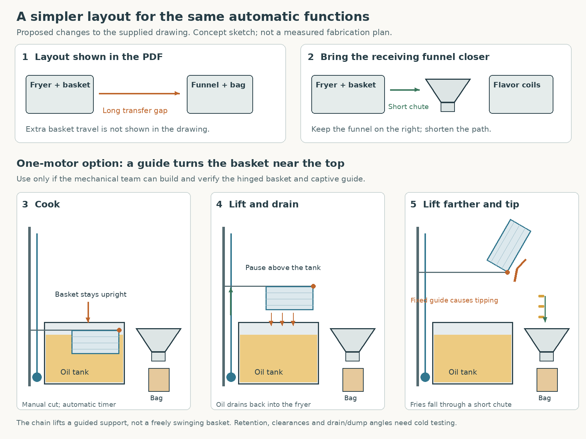

# Cheaper thesis design: proposed changes to the PDF

**SUPERSEDED — Step 12:** User requires the physical PDF design to remain unchanged and replaces potato-sensor start with flavor-button start. Relocated funnel, custom guided basket, manual-only normal fryer ON/OFF and associated partial prices below are historical alternatives, not the current design. See [current sequence and motor selection](MOTOR_SELECTION.md).

**PHASE 1: MATERIALS BUYING, Step 11. Reviewed 14 October 2026.** This is an alternative for discussion, not an approved fabrication plan or purchasing list. The existing spreadsheet contains the earlier, unapproved PHP 30,701.86 proposal. Its total has not been substituted with the incomplete estimates below.

The economical direction is to shorten the food-transfer path, use the fryer's existing temperature control, and purchase reusable electronics once. Automatic potato detection, timing, basket lifting/dumping and three electrical packet dispensers can remain. A single basket motor is conditional on the mechanical team's ability to make and verify a guided tipping mechanism. Operator-controlled normal fryer ON/OFF would be a deliberate change from the earlier controller-operated heater permission proposal; it is not yet approved.

## What the actual drawing tells us

Source: [drawing-fries (1).pdf](../drawing-fries%20(1).pdf), all ten pages reviewed. Page numbers below refer to PDF pages, not printed drawing labels. Dimensions and drawing units must be confirmed with the mechanical team before fabrication.

| PDF image | What is shown | Economical change and reason |
| --- | --- | --- |
| Pages 1–3: overall assembly | Cutter and fryer at the left; a receiving funnel and flavor coils farther to the right. | Bring the receiving funnel/bag holder beside the right edge of the fryer. A short gravity chute could carry fries into the bag. The drawing does not establish how a locally lifted basket reaches the distant funnel; a long transfer mechanism could add motors, guides, controls and expense. |
| Page 4: fryer/basket | Fryer body, basket and support arrangement. | Keep the oil tank stationary and retain a complete manufactured fryer's heater/control assembly. Move only the food basket and its supported bracket. Verify that the manufactured basket fits the proposed support without interfering with the heater or appliance controls. |
| Page 5: cutter | A manual potato cutter. | Keep it manual. Add a narrow discharge chute and a through-beam detector below it, away from oil splash/heat. No cutter motor is required. |
| Pages 7 and 9: chain/sprockets and basket bracket | Parts that could lift/support a basket. | Ask the mechanical team whether a guided, hinged support could also tip near the top of its lift. This could replace a separate rotation motor. The existing drawing alone does not demonstrate that capability. |
| Page 6: three spiral dispensers | Three horizontal coils for packets. | Keep one geared motor and one button per coil. Use an index switch to stop at the chosen dispensing position. Try a smaller motor only after checking loaded turning force and current. |
| Page 8: receiving funnel | Funnel with a large inlet and narrower outlet. | Keep a receiving funnel, but position its mouth under the basket's actual discharge path. Check outlet fit to the paper bag, chute slope, food-contact surface and clearance. Do not assume a reduced opening still passes fries without bridging. |
| Page 10: frame | The supporting structure. | If it has not been fabricated, ask whether the shorter arrangement can reduce frame length. Preserve stability, appliance access, guards and removal for cleaning. Electronics savings must not be offset by costly frame rebuilding. |

The illustration is newly drawn to explain changes. It is not a dimensioned build drawing, and the guide/roller geometry is schematic.

## How the cheaper basket arrangement could work

A **carriage** is a supported part that slides along guides. A **hinge** lets the basket rotate relative to that carriage. A **cam/guide** is a shaped path that pushes a roller or linkage as it moves, converting some upward movement into rotation.

1. During cooking, the basket rests in its intended upright position in the oil. The motor is not continuously running or required to hold an unsafe suspended load by power alone.
2. At the end of the requested cooking timer, the geared motor turns the chain sprocket. The chain raises the guided carriage carrying the basket. The basket remains upright.
3. The controller stops at a drain position above the tank. Oil drips back into the tank. Drain duration must be established experimentally; it is not yet a fixed recipe.
4. The same motor raises the carriage farther. A captive shaped guide acts on the hinged basket's roller/linkage and tips it toward the adjacent chute. Fries fall into the receiving funnel and bag.
5. The motor reverses. The guide returns the basket upright before it lowers into the cooking position.

This would need three basket-position indications: **HOME** (cooking position), **DRAIN** and **DUMP**. A limit/index switch is a small mechanically operated electrical switch; it reports position to the controller. It does not itself stop a falling load or provide an emergency power disconnect.

The chain must move a supported carriage, not a freely swinging basket. The mechanical team must provide positive basket retention, load holding when power is removed, chain guarding and enough clearance for tipping and cleaning. Motor sizing must include the empty basket/support, 300 g food, retained oil, friction and the extra force needed to tip through the guide. Food mass alone is insufficient.

**Practical choice:** use one motor only if the guide can be made cheaply and its whole motion proven with an unheated representative load. Otherwise, use two basket motors: one for lifting and one for rotation, while still moving the funnel closer. Two simple mechanisms can cost less overall than a difficult custom cam. Do not buy a basket motor until the mechanical arrangement establishes torque, speed, travel and load-holding requirements.

A published fryer design uses a curved guide to tilt a supported basket as it rises. This supports the general mechanical principle; it does not validate our chain arrangement, a complete dumping angle or the pictured chute. Our full-discharge arrangement remains an engineering proposal. [Primary patent description, FR3136643A1](https://patents.google.com/patent/FR3136643A1/en).

## Simplify heating without losing the automatic cooking cycle

The proposed cheaper split is:

- The operator turns the complete fryer on and sets its temperature before loading potatoes.
- The fryer's thermostat regulates heat. A thermostat senses temperature and switches the heater as required. Loading colder potatoes normally makes a thermostatic fryer demand more heat; it must not be forced to heat continuously for ten minutes.
- The controller monitors an appropriate oil-temperature probe, indicates READY, detects a valid potato drop and starts the cooking timer. It then manages basket and flavor motors.
- A hardware emergency disconnect and verified independent overheat protection remain separate from the controller. A frozen program must not be the only way to stop hazardous heat/motion.

This avoids designing another normal heater regulator. It also avoids the previously proposed controller-operated normal heater ON/OFF interface, **if the user accepts manual preheat/normal ON/OFF**. If automatic heater permission is required, price its actual switching and installation parts separately after selecting the fryer; do not restore a generic PHP 5,500 bundle without itemization.

The earlier B4 allowance was not a specific necessary product or a verified quote. Its functions must be reviewed individually, avoiding repeated charges for the already listed supply, motor drivers, DC fuses, wires or stop button. This does not establish that every power-protection function can be deleted. Recommend qualified school electrical supervision/inspection for mains work; free school assistance could replace paid labor only if actually available.

The Hanabishi candidate below has variable temperature control. Its public listing does **not** verify an independent overheat cutoff. Accept a fryer only after its manual/manufacturer information establishes the required protection and the mechanical team checks fit. Leave the appliance's mains/heater wiring intact.

## Three flavor buttons and coils

Each electrical button requests its own coil motor. The motor runs until the coil reaches its next indexed dispensing position, then stops. A timeout stops a motor and reports a fault if that position is not reached. Firmware must ignore held buttons/repeated presses during a dispense.

A small cam on each coil shaft can operate one index switch. Starting on the switch, the controller must see the coil leave that position and return before interpreting a completed turn. Packet spacing, coil pitch and end shape determine whether a turn releases exactly one packet. An index switch verifies rotation, not successful packet delivery. For an economical supervised demonstration, the operator can observe delivery; automatic packet-delivery confirmation remains an optional extra with its own sensor cost.

Candidate smaller motors are 12 V slow N20/JGA25 geared types, subject to actual loaded torque and stall-current checks. The rack must support the coils; the miniature motor must not be used as their structural bearing. **PHP 200 per motor below is an estimate, not a verified price for a suitable variant.** The Circuitrocks N20 listing offers different voltage/speed variants; its cheapest advertised variant must not be assumed equivalent to a 12 V slow motor. [Candidate listing](https://circuit.rocks/products/dc-geared-mini-motor-g12-n20).

If the smaller motor fails the loaded test, the earlier PHP 500 SGM370 candidate may be needed; three would add PHP 900 to the estimate below. Its listing title/description disagree about speed, and stall current must be verified before selection. [Makerlab candidate](https://makerlab.ph/products/dc-worm-gear-motor-sgm-370-12v-16rpm). Ordinary positional SG90 servos are unsuitable as direct repeated-full-turn coil drives.

## Candidate electronics and transparent cost arithmetic

Prices checked on 14 October 2026. Displayed prices exclude delivery and any applicable tax differences. **LISTED** means a price was observed, not that the item has passed compatibility or purchasing approval. **ESTIMATE** means an unverified planning allowance. Exact unselected parts are explicitly marked; this table must not be issued as the finalized Phase 1 buying BOM.

| Item | Candidate model/specification | Qty | Unit PHP | Subtotal PHP | Source/status | What it does |
| --- | --- | ---: | ---: | ---: | --- | --- |
| Controller | Mega2560 Pro Mini, ATmega2560/CH340 | 1 | 495.00 | 495.00 | e-Gizmo, LISTED, preorder | Reads buttons/sensors and manages the timed sequence. Smaller/cheaper board, same processor family; unsoldered headers and USB cable need checking. |
| Potato detector | DFRobot SEN0503 through-beam pair | 1 pair | 277.43 | 277.43 | DigiKey PH prior listed snapshot; recheck tax/delivery | Starts the cooking cycle when strips interrupt a constrained beam. Install within its environmental ratings, outside the hot/splash area. |
| Display | 16x2 LCD with I2C interface | 1 | 150.00 | 150.00 | Makerlab, LISTED | Shows READY, remaining time and faults; inexpensive enough to keep for a beginner demonstration. |
| Basket motor driver | BTS7960 module | 1 | 268.00 | 268.00 | Circuitrocks, LISTED | Reverses the one basket motor. Its advertised 43 A is not a proven continuous module rating; compatibility depends on actual motor current and cooling. |
| Flavor motors | Three matching 12 V slow N20/JGA25 candidates; variant unselected | 3 | 200.00 | 600.00 | ESTIMATE | Turn the three coils, conditional on successful loaded tests. |
| Flavor switching parts | Three correctly rated MOSFET/diode/resistor circuits; final ratings unselected | 3 | 160.00 | 480.00 | ESTIMATE | Let the controller switch motor current. Diodes suppress motor turn-off voltage spikes; actual stall current determines ratings. |
| Position switches | KW11-style microswitch candidates; mounting/environment to verify | 6 | 40.00 | 240.00 | ESTIMATE | Three basket positions and three coil indexes. These do not replace load retention or independent stop protection. |
| User buttons | Three flavor, ARM/ready acknowledgement, cancel | 5 | 35.00 | 175.00 | ESTIMATE | Local operating controls. Software cancel differs from a hardware emergency disconnect. |
| Indicators | Low-voltage buzzer/LEDs and resistors | 1 set | 100.00 | 100.00 | ESTIMATE | Signals readiness, completion and faults. |
| Logic regulator | LM2596 buck module | 1 | 45.00 | 45.00 | Earlier e-Gizmo listing snapshot; recheck | Reduces the selected DC supply to the controller's intended 5 V logic supply, subject to actual board power-input verification. |
| Filtering/support parts | Capacitors/resistors; final values depend on layout | 1 set | 200.00 | 200.00 | ESTIMATE | Helps keep motor electrical noise from resetting or falsely triggering the controls. |
| Temperature interface | MAX6675 module | 1 | 199.00 | 199.00 | e-Gizmo, LISTED snapshot, preorder | Reads a compatible K-type probe; the supplied generic probe is not established suitable for frying oil. |
| Oil-temperature probe | Documented food-contact, oil-immersion, ungrounded K-type probe and clamp; model unselected | 1 | 1,000.00 | 1,000.00 | ESTIMATE | Establishes oil readiness/monitoring. A metal tip alone does not prove food/oil suitability. |
| **Candidate control/sensing subtotal** | **Includes estimated flavor motors; excludes basket motor and power/protection below** | | | **4,229.43** | **Partial subtotal, not a working-machine price** | |

The same subtotal without the temperature interface/probe is PHP 3,030.43, but that removes controller oil-temperature monitoring and is **not** the recommended monitored alternative. No such omission is approved.

Additional unresolved costs must be counted:

| Additional requirement | Planning PHP | Status and limitation |
| --- | ---: | --- |
| One final basket motor | 2,000.00 | ESTIMATE inherited from the earlier proposal; no model selected. One motor might require more torque than either motor in a two-axis design. |
| Suitable final DC supply | 1,500.00 | ESTIMATE retained pending rated/running/start/stall current and duty-cycle sizing. A cheaper closed adapter is possible only if all required ratings are adequate. |
| Permanent low-voltage board, enclosure, DC wiring, fuses/connectors and strain relief | 1,200.00 | ESTIMATE for a smaller assembly; exact quantities/current ratings and moving cables still need checking. Does not include a mains panel/disconnect. |
| **Control + low-voltage motion planning subtotal** | **8,929.43** | **Partial, contains unverified allowances.** |
| Complete fryer candidate | 5,325.00 | Hanabishi HFRY60SS LISTED; protection/fit not yet verified. A different accepted fryer may change this price. |
| **Subtotal including fryer candidate** | **14,254.43** | **Incomplete planning subtotal, not a final quotation.** |
| Independent emergency power disconnect, any required guard interlock and mains installation/protection | **Unpriced** | Specify actual equipment and verified existing site/appliance protection; no replacement lump sum invented. |
| Qualified inspection/commissioning | **Unpriced** | Ask school about qualified assistance; availability and cost unknown. |
| USB cable/headers and any unborrowed temporary prototyping supplies | **Unpriced** | Check controller package and school equipment before purchasing. Reuse final components for cold tests instead of buying duplicate motors/supplies. |
| Mechanical fabrication/guide, chute, load restraint, guards; shipping; food/packaging; extra tools | **Excluded** | Mechanical team scope and other non-electronics costs. A cam can increase this cost even as it reduces electronics. |

**A truthful final total cannot yet be given.** PHP 14,254.43 demonstrates a lower-cost candidate combination before the explicitly unpriced requirements; it does not promise a complete machine for that amount or a guaranteed percentage saving. The earlier PHP 30,701.86 included substantial unquoted allowances, so it is not a reliable market-price benchmark either.

With unchanged allowances, reverting to two basket motors adds PHP 2,000 plus one PHP 268 driver, bringing the fryer-inclusive partial subtotal to PHP 16,522.43 before additional tilt sensing, wiring and any supply changes. This is only comparison arithmetic: the actual two motors may have different requirements and prices.

Listed-price references: [controller](https://e-gizmo.net/gizmoshop/index.php?path=59_66_99&product_id=1463&route=product/product), [display](https://makerlab.ph/products/16x2-lcd-display-i2c-black-on-green), [basket driver](https://circuit.rocks/products/motor-large-current-driver-module-bts7960-43a), [temperature interface](https://www.e-gizmo.net/gizmoshop/index.php?product_id=1295&route=product/product), [drop detector](https://www.digikey.ph/en/products/detail/dfrobot/SEN0503/15283061), [fryer](https://myhanabishi.com/products/deep-fryer-hfry-60ss).

## Compatibility and purchase order considerations

- Intended arrangement is 5 V controller/sensor logic with separately supplied nominal 12 V motors. Motor power must not flow through controller pins. Verify the actual Pro Mini labels, regulator/input arrangement and headers before writing a pin table; this is not the familiar small ATmega328P Pro Mini.
- Reserve approximately 32 controller signals: one potato sensor, three K-type interface signals, two I2C display signals, six positions, five buttons, four reversible-driver signals, three coil outputs, two indicators and spare hardware-stop/guard-status inputs. The Mega family provides sufficient I/O without adding an expander. Exact wiring belongs to Phase 2 after the design is selected.
- Confirm the beam sensor's output and 5 V operation, LCD supply/interface, K-type probe junction and each driver input before purchase. SEN0503 is not an oil-immersed or high-temperature sensor; its stated ambient limit is 60 °C. [Manufacturer](https://www.dfrobot.com/product-2388.html).
- Driver, wiring, fuse and supply sizing require **stall current**: current when a motor is prevented from turning, often much higher than its normal running current. No overall motor power budget is credible before motor selection. Avoid overlapping basket/coil motion where practical, but do not assume scheduling removes startup/stall requirements.
- A PHP 185 12 V/5 A adapter listing is not sufficient evidence that it can start/hold the basket system safely. For comparison, a PHP 700 12 V/19 RPM motor listing states 20 A stall current. Those two parts cannot be assumed a reliable pair. [Adapter candidate](https://makerlab.ph/products/12v5a-supply-adapter), [motor specifications](https://makerlab.ph/products/dc-gear-motor-12v-19rpm-sgm37-550).
- Use the selected final motors/supply for cold component testing when appropriate; omit the earlier two extra bench-only motors and duplicate bench supply if school equipment or the selected parts can serve that purpose. Reused electronics must appear once in the approved Table A/B BOM, not be bought twice.
- Keep ready/position/fault indications, timeouts and independent protection. Optional packet/bag/current diagnostics can be reviewed for a supervised demonstrator; operator observation has less fault-detection capability and must be stated honestly.

## Decision needed before replacing the spreadsheet

First establish whether the mechanical team can move the funnel closer and alter the basket support/linkage. If yes, compare the fabrication cost of the one-motor guide against a simpler two-motor support. Then agree the normal fryer ON/OFF scope and select the actual motors, supply, protected fryer and itemized independent stop/protection components.

Only then replace the old spreadsheet and its two buying tables with an approved, non-duplicating BOM. Remain in Phase 1 until that review is complete and the user approves Phase 2. No physical build, firmware, installation or flashing has been performed.
